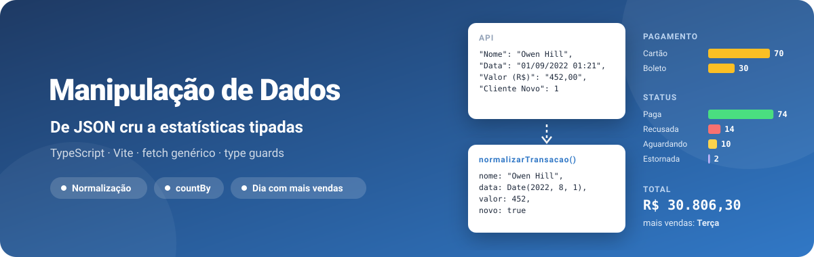
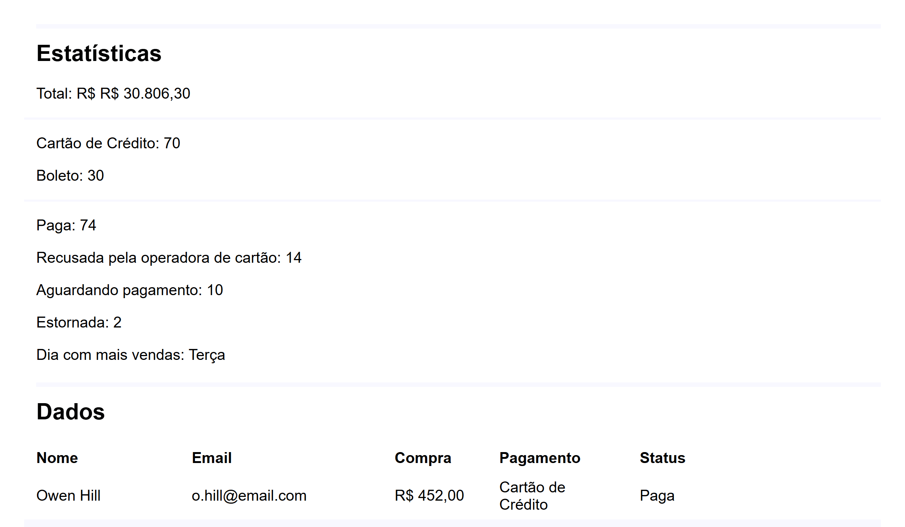
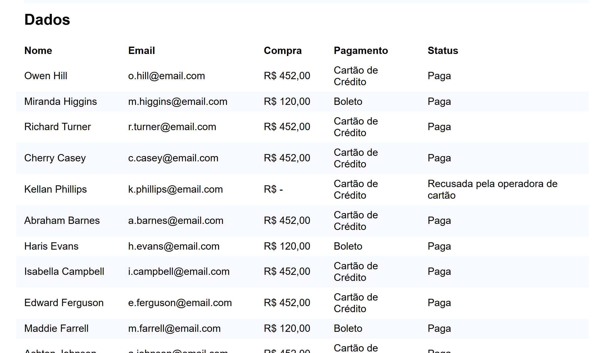

<div align="center">



**Busca 100 transações de uma API, normaliza cada registro para um tipo próprio e mostra estatísticas e uma tabela. TypeScript puro com Vite.**

[](tsconfig.json)
[](package.json)
[](https://github.com/kessleru/Manipulacao-Dados-ts/commits/main)



</div>

## Sobre

Um exercício de **tipar dados que chegam sujos**. A API
[`transacoes.json`](https://api.origamid.dev/json/transacoes.json) devolve chaves com espaço e
parênteses (`"Valor (R$)"`, `"Forma de Pagamento"`), valores monetários como texto (`"452,00"`, ou `"-"`
quando não houve cobrança), datas no formato `dd/MM/yyyy HH:mm` e um booleano escrito como `0`/`1`.

O projeto declara dois tipos — `TransacaoAPI`, o formato que chega, e `Transacao`, o formato que o
resto do código usa — e uma função que converte um no outro. A partir daí, tudo é tipado: a classe
`Estatisticas` soma, conta e acha o dia da semana com mais vendas sem precisar saber como a API
escreve as coisas.

```ts
function normalizarTransacao(transacao: TransacaoAPI): Transacao {
  return {
    nome: transacao.Nome,
    data: stringToDate(transacao.Data),              // "01/09/2022 01:21" → Date
    valor: moedaParaNumero(transacao['Valor (R$)']), // "452,00" → 452 | "-" → null
    novo: Boolean(transacao['Cliente Novo']),        // 1 → true
    // …
  };
}
```

## Telas



Na captura (29/09/2026), a API devolveu 100 transações: 70 no cartão e 30 no boleto; 74 pagas, 14
recusadas, 10 aguardando pagamento e 2 estornadas; total de R$ 30.806,30, com terça-feira como o dia
de mais vendas.

## Como funciona

| Arquivo | Papel |
|---|---|
| [`fetchData.ts`](src/fetchData.ts) | `fetchData<T>(url)` genérico: devolve `T` ou `null`, e loga o erro |
| [`normalizarTransacao.ts`](src/normalizarTransacao.ts) | Tipos globais `TransacaoAPI` e `Transacao` e a conversão entre eles |
| [`moedaParaNumero.ts`](src/moedaParaNumero.ts) | `"1.234,56"` → `1234.56`; `null` se não for número |
| [`stringToDate.ts`](src/stringToDate.ts) | `"dd/MM/yyyy HH:mm"` → `Date`; `null` se faltar alguma parte |
| [`countBy.ts`](src/countBy.ts) | Conta ocorrências de cada valor de uma lista |
| [`Estastisticas.ts`](src/Estastisticas.ts) | Total (com *type guard* que descarta `valor: null`), pagamentos, status e melhor dia |
| [`main.ts`](src/main.ts) | Busca, normaliza e preenche a tabela e as estatísticas no HTML |

### Limitações conhecidas

- O total aparece como `R$ R$ 30.806,30`: o HTML já escreve `R$` antes do `<span>` e o
  `toLocaleString` com `currency: 'BRL'` escreve de novo.
- Transações sem cobrança mostram `R$ -` na tabela, porque a coluna usa o texto original da API.
- O Tailwind está instalado e configurado no Vite, mas o `import './style.css'` está comentado — a
  página usa só o CSS do `<style>` no `index.html`.

## Stack

| Camada | Ferramenta |
|---|---|
| Linguagem | [TypeScript](https://www.typescriptlang.org) |
| Build | [Vite](https://vite.dev) |
| Dados | [API de transações da Origamid](https://api.origamid.dev/json/transacoes.json) |
| Pacotes | [pnpm](https://pnpm.io) |

## Rodando localmente

```bash
git clone https://github.com/kessleru/Manipulacao-Dados-ts.git
cd Manipulacao-Dados-ts
pnpm install
pnpm dev
```

O Vite sobe em `http://localhost:5173`. A página precisa de internet para buscar as transações.

### Scripts

| Comando | O que faz |
|---|---|
| `pnpm dev` | Servidor de desenvolvimento |
| `pnpm build` | `tsc` (checagem de tipos) + build de produção em `dist/` |
| `pnpm preview` | Serve o build em `http://localhost:4173` |

<details>
<summary><b>Regerando as imagens deste README</b></summary>

```bash
node .github/readme/gerar.mjs                 # banner.svg

pnpm build && pnpm preview                    # em outro terminal
pnpm add -D puppeteer-core sharp              # desfaça depois com git restore
node .github/readme/capturar.mjs              # telas em 2x
```

</details>

---

<div align="center">
<sub>Feito por <a href="https://github.com/kessleru">Otávio Kessler Ustra</a></sub>
</div>
